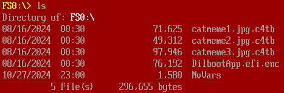
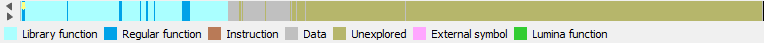

```
A dire situation has arisen, yet again, at FLARE HQ. One of our employees has 
fallen victim to a ransomware attack, and the culprit is none other than the 
notorious Catbert, our malevolent HR manager. Catbert has encrypted the 
employee's disk, leaving behind a cryptic message and a seemingly innocent 
decryption utility. However, this utility is not as straightforward as it 
seems. It's deeply embedded within the firmware and requires a keen eye and 
technical prowess to extract. The employee's most valuable files are at stake, 
and time is of the essence. Please, help us out one.... last... time.
```

## Table of Contents

## Triage (Static)

We're given two files:
```bash
$ file *
bios.bin: data
disk.img: DOS/MBR boot sector, blah blah blah
```
Presumably `bios.bin` is the decryption utility, and `disk.img` is the encrypted disk. 

- `binwalk` over `bios.bin` attempts to extract something that *looks like* a PE, but it's not quite right and the flavour text implies it takes effort to get working.
- `disk.img` has a header `C4TBT` some ways into the sample, and other similar text.

`strings` over the bios implies https://github.com/tianocore/edk2 was used to compile the challenge.

## Triage (Dynamic)

I was able to run the program with `qemu-system-x86_64 -bios bios.bin  -drive file=disk.img,format=raw,index=0,media=disk`.

Some flavour text is given, ending in the following:
```
===========================================================================
Courtesy 
===========================================================================
Ah, yes. I have bestowed upon you the privilege of decrypting four files, 
free of charge. Well, to be perfectly frank, you’ll need to exercise your 
considerable intellect to decipher the first three images. The fourth 
executable, however, is my gift to you after figuring out the first three. 
Consider it a token of my... esteem.

You’ll find the necessary decryption tool within this very shell. Now, if 
you’ll excuse me, I have more pressing matters to attend to. Like, say, 
plotting the downfall of humanity. 

Meow-hahahahaha! 

Catbert 

P.S. Don’t even think about contacting the authorities. 
They’re too busy chasing their own tails. 

Press <PgUp> and <PgDown> to scroll up and down. Type ‘fs0:’ to access a 
mounted disk, or ‘map -r’ to see all mounted disks. 
C4tShell>_
```

Running `help` I can see an interesting command:
```
decrypt_file  - Decrypts a user chosen .c4tb file from a mounted storage, given a decryption key
```

I can also see the files on `disk.img`.


## Rainman the Header
I took a cheeky peek at each file, and guessed the following pattern.

| Offset | Description                                              |
| ------ | -------------------------------------------------------- |
| `0x0`  | `C4TB` magic                                             |
| `0x4`  | Offset to end of encrypted data (relative to header)     |
| `0x8`  | Size of initial data structure (including header, padding NULLs) |
| `0xc`  | Size of trailing data structure (VM)                         |

Eg:
```
00000000  43 34 54 42 54 15 01 00  70 15 01 00 59 02 00 00  |C4TBT...p...Y...|
...
00011550  10 e2 c2 8e 95 da cb 30  33 6b 03 31 18 ae 41 a0  |.......03k.1..A.|
00011560  a9 45 88 18 00 00 00 00  00 00 00 00 00 00 00 00  |.E..............|
00011570  01 00 00 01 bb aa 06 01  00 01 01 dd cc 06 01 00  |................|
...
000117b0  18 01 00 17 05 01 00 10  11 10 02 53 01 00 19 01  |...........S....|
000117c0  00 01 06 01 00 19 05 19  18                       |.........|
000117c9
```

## Driver Extraction
I ran [UEFITool](https://github.com/LongSoft/UEFITool) over `bios.bin`, one of the files that was extracted appeared to be LZMA compressed (thanks `file`/Cyberchef). Used Cyberchef to try to decompress it, and eventually found ransomware strings in it. I was able to narrow it down to the `Shell` driver, and used `UEFITool` again to extract it. IDA happily loaded it.

## Side Mission: Building [EDK2](https://github.com/tianocore/edk2)
I spotted debug strings for the Shell and wanted to build them. They ended up being minimally helpful, the amount of effort and time required was not worth it. Reach out to me if you're interested in the debug symbols and I'll send them. They did work, but by the time I had compiled the program I'd already figured out which functions were relevant.



## Virtual Machine
Reverse engineering the binary reveals the key bytes given to `decrypt_file` are passed as input into a stack-based Virtual Machine program which is embedded at the end of each `.c4tb` file. If the VM is satisfied then the key is used as an RC4 key to decrypt the file.

It's clear that it's a VM because there's numerous opcode handlers that perform simple CPU operations, and it's clear that it's stack-based because most opcode handlers don't expect any operands - instead reading from relative offsets - and then place the result of operations back at the offset.

### Disassembler
